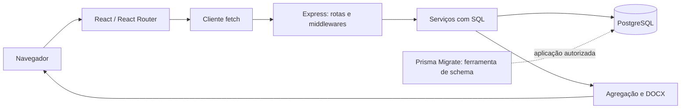

# Arquitetura implementada

[Índice](README.md) · [Rastreabilidade](rastreabilidade.md)

Base e convenções: [escopo documental](README.md). Arquitetura inspecionada
estaticamente; infraestrutura descrita não significa infraestrutura implantada.

## Componentes e fluxo

O diagrama representa dependências lógicas, não uma topologia de produção.

| Componente | Responsabilidade | Fonte |
|---|---|---|
| React 19 / Router 7 / Vite 8 | SPA, páginas e build; versões declaradas são faixas, conferir lockfile para resolução exata | [manifest frontend](../frontend/package.json) |
| Rotas frontend | Login público; layout protegido e oito páginas; fallback para raiz | [AppRoutes](../frontend/src/routes/AppRoutes.jsx) |
| Contexto e cliente HTTP | Token/usuário em localStorage; login; logout local; Bearer e tratamento de 401/erros | [AuthProvider](../frontend/src/contexts/AuthProvider.jsx), [API](../frontend/src/services/api.js) |
| Hooks | Paginação, detalhes e vínculo de Project; cancelamento/descarte de respostas em escopos específicos | [hooks](../frontend/src/hooks/) |
| Express 5 | Composição HTTP, routers, parser, segurança e erros | [app.js](../backend/src/app.js), [manifest backend](../backend/package.json) |
| JWT/RBAC/Zod | Identidade, blocklist, autorização e validação | [middleware](../backend/src/middleware/), [validators](../backend/src/validators/) |
| Serviços | Regras de negócio e SQL parametrizado; não há controllers/repositórios independentes | [services](../backend/src/services/) |
| PostgreSQL / pg | Pool e persistência relacional | [db.js](../backend/src/db.js), [schema](../backend/prisma/schema.prisma) |
| Prisma 7.8 | Schema e histórico de migrations; consultas da API não usam Prisma Client | [migrations](../backend/prisma/migrations/), [guia](../backend/MIGRATIONS.md) |
| docx | Exportação binária de relatórios no backend | [rota de relatórios](../backend/src/routes/relatorios.js) |
| Swagger | swagger-jsdoc lê anotações; UI e JSON publicados pelo Express | [swagger.js](../backend/src/swagger.js) |

## Módulos e persistência

| Módulo | Dados e superfície | Particularidade |
|---|---|---|
| Autenticação/administração | users, revoked_tokens, password_reset_tokens; `/auth`, `/admin/usuarios` | Perfis admin/qa/reader; sem UI administrativa completa identificada |
| Projects | projects; `/projects`; tela Projects | Catálogo independente com auditoria transacional |
| Test Cases | projetos; `/projetos`; tela TestCases | Nome legado preservado; vínculo opcional project_id e cenarios JSONB |
| Requirements | requirements; `/requirements` | Sem relação implementada com Projects ou Test Cases no modelo examinado |
| Test Suites | test_suites, test_suite_cases; `/test-suites` | Casos reutilizáveis; projeto_id legado não referencia o catálogo projects |
| Test Plans | test_plans, test_plan_suites; `/test-plans` | Elegibilidade e execução única; vínculo execucoes.plan_id |
| Executions | execucoes, execution_results; `/execucoes` | Registro/edição manual de resultados; não executa automaticamente scripts de teste |
| Reports/Dashboard | Consultas a execuções/casos/suítes; `/relatorios`, `/stats` | Agregados e DOCX; referências históricas legadas |
| Auditoria/saúde | audit_logs; `/admin/audit-log`, `/health` | Auditoria não uniforme; saúde consulta banco |

Relações e semântica detalhadas permanecem nos contratos de
[Projects/Test Cases](../backend/PROJECTS-PERSISTENCE-CONTRACT.md) e
[Test Plans](../backend/TEST-PLAN-LIFECYCLE.md). Não converter identidades ou
inferir vínculo histórico por nome, data ou igualdade de IDs.

## Segurança e limites de composição

Em operação normal, a camada JWT precede os recursos protegidos. RBAC é verificado
no servidor; a UI apenas controla visibilidade/ações. `/auth` contém rotas públicas
e logout com middleware próprio. `/health`, `/api-docs` e `/openapi.json` são
montados antes da autenticação; também precedem Helmet/CORS/limiter global.

Com `NODE_ENV=test`, app.js injeta usuário e perfil de teste nos recursos
protegidos, em vez da autenticação global. Não usar esse modo como implantação ou
como comprovação de segurança integrada. Limitadores também possuem bypass de teste.

Não há integração de envio de e-mail implementada no fluxo de reset inspecionado.
Logout visual não chama revogação; papel no JWT pode permanecer antigo após mudança.
Frontend utiliza fallback de API local e importa páginas antecipadamente.
Consultar [RNFs](requisitos/nao-funcionais.md) e ressalvas no [roadmap](../roadmap.md).

## Infraestrutura disponível versus implantação

| Artefato disponível | O que comprova | O que não comprova |
|---|---|---|
| [Dockerfile backend](../backend/Dockerfile) | Estágios Node 22 Alpine, usuário node e health check | Container rodando, segurança homologada ou schema aplicado |
| [Dockerfile frontend](../frontend/Dockerfile) e [Nginx](../frontend/nginx.conf) | Build e serviço de arquivos SPA | TLS real, URL adequada de API ou comportamento em navegador |
| [Compose local](../docker-compose.yml) | Configuração de serviços e inicialização SQL legada | Equivalência ao histórico completo de migrations |
| [Compose produção](../docker-compose.prod.yml) | Configuração separada de imagens/serviços | Implantação realizada, TLS, backup recuperável ou disponibilidade |
| [Compose integração](../docker-compose.integration.yml) | Recursos/guardas de ambiente específico | Autorização para reutilizar, limpar ou recriar o ambiente |

Não foi identificada evidência de implantação de produção nesta revisão. O uso local
e o experimento com outro computador não representam homologação de produção.
Não foram consultados containers, sockets, bancos ou configuração real de rede.

## Consistência, operação e validação

- Projects usa transação para negócio e auditoria. Planos bloqueiam a linha pai e
  criam execução/resultados na mesma transação. Vínculo de caso com Project ativo
  utiliza lock do pai; auditoria legada continua fora dessa transação.
- Finalização, edição de resultado e reset de senha não possuem transação abrangente
  equivalente. Não estender garantias de um serviço aos demais.
- Dashboard executa DDL na consulta e retorna zeros em erro. Reports pode carregar
  todos os resultados e usar uma consulta de casos por execução; não há orçamento
  de recursos aprovado. Health inclui mensagem de erro do banco quando degradado.
- Testes frontend usam mocks/VM e não equivalem a React DOM em navegador. Integrações
  e homologações anteriores são evidências históricas com escopo delimitado.
- As portas 5433, 5434, 5435 e 5436 correspondem a destinos preservados; documentação
  não autoriza conexão, migrations ou limpeza. Ver [estado](../backend/FEATURE-VALIDATION-STATUS.md).
- Node 22 é a linha operacional documentada; há validações recentes com Node 26 no
  [roadmap](../roadmap.md). Não declarar suporte irrestrito a todas as versões.
